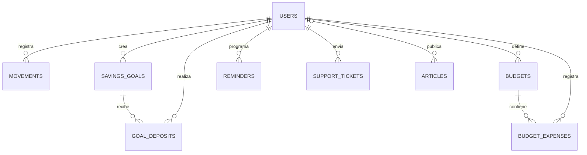

# Modelo entidad-relación (MER) de Cashly

## Entidades principales
- **users**: cuenta, credenciales cifradas, rol, estado, datos personales, avatar y tema.
- **movements**: ingresos y gastos individuales con categoría, medio de pago, fecha y descripción.
- **savings_goals / goal_deposits**: objetivos de ahorro y sus abonos.
- **budgets / budget_expenses**: límites por periodicidad y gastos imputados.
- **reminders**: pagos, suscripciones y fechas importantes.
- **articles**: artículos educativos publicados por administración.
- **support_tickets**: PQRS, consultas y reportes de errores.

Todas las entidades privadas están relacionadas con `users` y se consultan usando el identificador de la sesión. Las claves foráneas usan borrado en cascada cuando los datos pertenecen exclusivamente a la cuenta.
